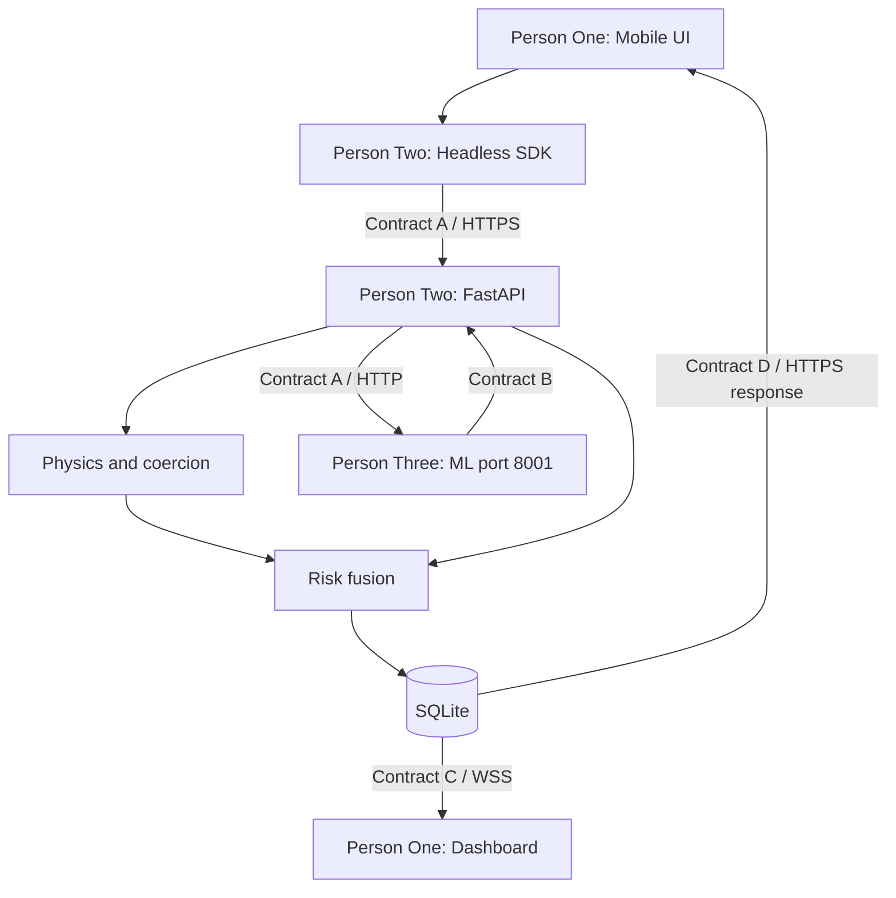

# Architecture and integration boundaries

The runtime implements the shared boundaries in PRD pages 1–3, 6–9, and 11.

## Runtime

Run one backend worker with an in-memory connection registry and SQLite. Shared messaging is required before multiple workers. Use an explicit mock ML adapter during development and an async HTTP adapter for live ML; failed live requests must never silently turn into mock scores.

## Sequence

1. A UI callback activates sensors; the SDK starts a session and bounded buffers.
2. At transfer confirmation, serialize permitted measurements as Contract A.
3. Validate and check duplicate submission before invoking side effects.
4. Run physics/coercion and request ML evidence.
5. Apply explicit PRD hold rules first, then the agreed general policy.
6. Persist evidence, decision, and policy version atomically.
7. Broadcast C and return D. Dashboard initialization recovers persisted results after disconnect.

Contract C carries the final session snapshot. General identity scoring has a 1.5-second budget. A conclusive local hold has a 75 ms identity budget. When that deadline expires the event records the local evidence, the deadline flag and null identity values. The original decision stays immutable. Full phone latency also includes collection, validation, storage, delivery and network time.

## Handoffs

| Boundary | Person Two provides | Other owner provides |
| --- | --- | --- |
| Mobile | SDK/hook, states/errors, A/D fixtures | Person One: activation, keypad/input and slider callbacks, outcome UI |
| Dashboard | C fixtures, init schema, connection/recovery behavior | Person One: map/gauges/feed, demo and operator callbacks |
| Identity | A fixtures, units/timing, recordings, timeouts | Person Three: B, map/ban schemas, safe-baseline policy |

## Deployment and limits

Develop with HTTPS/WSS on real phones. For the offline final, run all services and assets locally over LAN with HTTPS trusted by both phones. Rehearse with internet disabled; a cloud tunnel cannot be the offline dependency.

The demo simulates transfers and holds; it does not reserve actual funds. Browser injection does not establish detection of all remote-control tools. Coercion indicators require calibration. Dossiers are prototype downloads, not confirmed official schemas or submissions.
